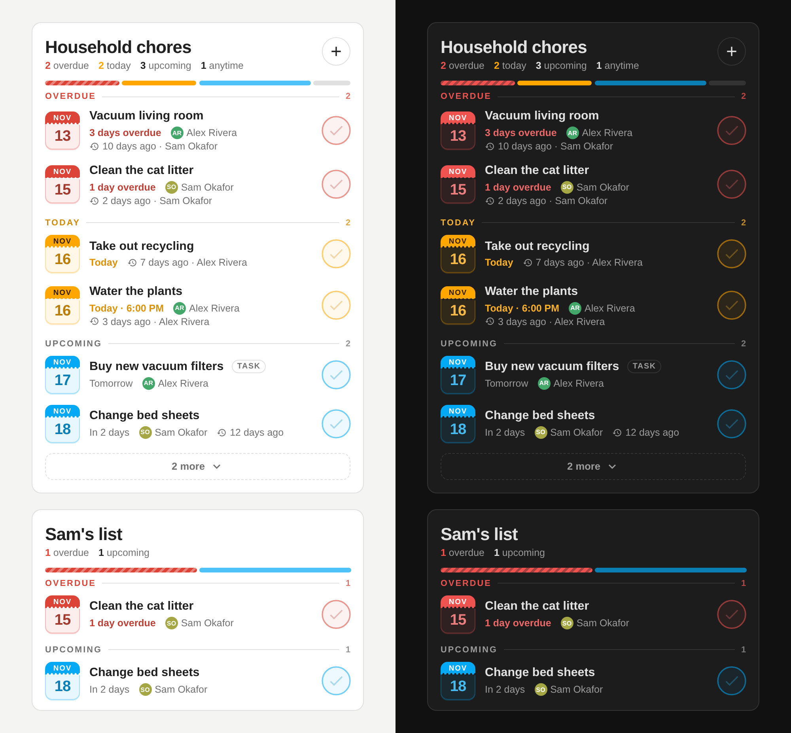

# Grocy Chore Card

A Home Assistant dashboard card for [Grocy](https://grocy.info) chores and tasks. You can see what's overdue, due today or coming up, and mark things done with one tap.

It replaces the archived [lovelace-grocy-chores-card](https://github.com/isabellaalstrom/lovelace-grocy-chores-card). It does the same job, has a new design, and accepts most of the old options.



## What it does

- **Tap ✓ to complete.** Chores are tracked with `grocy.execute_chore` and tasks are completed with `grocy.complete_task`. A ring fills for 3 seconds before the call is made, and tapping again during that time cancels it. The undo window is configurable, and `undo_seconds: 0` completes immediately.
- **Calendar stubs.** Each item shows its due date as a tear-off calendar page, coloured red for overdue, amber for today and blue for this week.
- **Grouping and an urgency bar.** Items are grouped into Overdue, Today, Upcoming and Anytime. A bar under the title shows how many items fall in each group.
- **Tap a row for details.** This shows the description, who did it last and who it's assigned to. From there you can **skip** a chore, **move** an item to another date, or **assign it to yourself**.
- **Add tasks.** Set `show_create_task: true` to add tasks from the card.
- **Works with your theme.** All colours come from your Home Assistant theme, so light, dark and custom themes all work.
- **Visual editor.** You can configure the card without YAML.

## Requirements

You need the [Grocy integration](https://github.com/custom-components/grocy). The original repository is unmaintained, and an active fork is at [iamkarlson/grocy](https://github.com/iamkarlson/grocy). Enable its **chores** and/or **tasks** sensors, which are usually `sensor.grocy_chores` and `sensor.grocy_tasks`.

## Installation

### HACS

1. HACS → ⋮ → **Custom repositories** → add `https://github.com/jcsumlin/grocy-card-ha` with category **Dashboard**.
2. Install **Grocy Chore Card** and reload the browser.

### Manual

Download `grocy-chore-card.js` from the [latest release](https://github.com/jcsumlin/grocy-card-ha/releases). Copy it to `config/www/`. Then add `/local/grocy-chore-card.js` under **Settings → Dashboards → Resources**, with type *JavaScript module*.

## Configuration

The simplest setup:

```yaml
type: custom:grocy-chore-card
entity:
  - sensor.grocy_chores
  - sensor.grocy_tasks
```

A shared household card that records completions as whoever is logged in:

```yaml
type: custom:grocy-chore-card
title: House
entity: [sensor.grocy_chores, sensor.grocy_tasks]
user_id:
  Alex: 1        # Home Assistant user name → Grocy user id
  Sam: 2
  default: 1
show_days: 7
show_quantity: 8
show_create_task: true
```

A personal card on a wall tablet:

```yaml
type: custom:grocy-chore-card
title: My chores
entity: sensor.grocy_chores
user_id: { Alex: 1, Sam: 2, default: 1 }
filter_user: current
show_unassigned: true
```

### Options

| Option | Default | Description |
|---|---|---|
| `entity` | **required** | One Grocy sensor or a list of them. Chores and tasks can be mixed. |
| `title` | `Chores` | Card title. |
| `user_id` | `1` | The Grocy user that completions are recorded as. This is a number, or a map of Home Assistant user name to Grocy id with a `default` entry. |
| `undo_seconds` | `3` | How long you have to undo after tapping ✓. Set to `0` to complete immediately. |
| `track_execution_now` | `false` | Record the chore as done now. When false, the integration records it at the scheduled time. |
| **Filtering** | | |
| `show_days` | all | `N` shows overdue items plus items due within N days. `"a..b"` shows only items due between a and b days from today. |
| `show_quantity` | all | Show at most this many items. The rest go behind a "N more" button. |
| `filter` | — | Only show items whose name contains this text. Case-insensitive; a list matches any entry. |
| `remove_filter` | `false` | Remove the `filter` text from the displayed names. |
| `filter_user` | — | Only show items assigned to this Grocy user id, a list of ids, or `current` (the id `user_id` resolves to). |
| `show_unassigned` | see note | With `filter_user`, also show unassigned items (default `false`). Without `filter_user`, set it to `false` to hide unassigned items. |
| `filter_task_category` | — | Only show tasks in these category ids. Chores are not affected. |
| `show_chores_without_due` | `true` | Include chores that have no due date. |
| `show_tasks_without_due` | `true` | Include tasks that have no due date. |
| **Layout** | | |
| `group_by_due` | `true` | Group items under Overdue, Today, Upcoming and Anytime headings. |
| `sort_by` | `due` | `due`, `name`, `assignee` or `last_tracked`. |
| `sort_order` | `asc` | `asc` or `desc`. Items without a value always sort last. |
| `due_in_days_threshold` | `7` | Show "In N days" for items due sooner than this, and the date for later ones. Upcoming items within this window are coloured blue. |
| `show_header` | `true` | Show the title and counts. |
| `show_summary_bar` | `true` | Show the urgency bar. |
| `show_due_date` | `true` | Show the due date text. |
| `show_assigned` | `true` | Show the assignee. |
| `show_last_tracked` | `true` | Show when a chore was last done. |
| `show_last_tracked_by` | `true` | Show who did it last. |
| `show_description` | `false` | Show descriptions in the list. They are always shown in the details panel. |
| `show_empty` | `true` | Show an "All caught up" message when nothing is due. When `false`, the card hides itself. |
| **Actions** | | |
| `show_track_button` | `true` | Show the ✓ button. |
| `show_details` | `true` | Open the details panel when a row is tapped. |
| `show_skip` | `true` | Show **Skip this time** for chores. |
| `show_reschedule` | `true` | Show **Move to** with a date picker. |
| `show_assign_to_me` | `true` | Show **Assign to me** for items not assigned to you. |
| `show_create_task` | `false` | Show a **+** button for adding tasks. |
| `custom_translation` | — | Replace any text in the card. Keys can be either the string key or the English text, for example `{ today: Heute, "Tomorrow": Morgen }`. The full list is in [`src/localize.ts`](src/localize.ts). |

### Theming

Colours come from the active theme: `error-color`, `warning-color`, `primary-color`, `success-color` and `divider-color`. To change them for this card only, set these variables in a theme or with card-mod:

`--grocy-overdue-color`, `--grocy-today-color`, `--grocy-soon-color`, `--grocy-later-color`, `--grocy-done-color`, `--grocy-font-family`.

## Migrating from `grocy-chores-card`

1. Change `type: custom:grocy-chores-card` to `type: custom:grocy-chore-card`.
2. Most options work unchanged, including `entity`, `title`, `user_id`, `show_quantity`, `show_days`, `filter`, `remove_filter`, `filter_user`, `show_unassigned`, `filter_task_category`, the `show_*` toggles, `due_in_days_threshold`, `show_create_task` and `custom_translation`.

These options behave differently:

| Old | New |
|---|---|
| Unassigned items hidden unless `show_unassigned: true` | Unassigned items are shown unless you filter by user. |
| `show_overflow` | Always on: extra items go behind a "N more" button. |
| `show_skip_next`, `show_enable_reschedule`, `show_more_info_popup` | `show_skip`, `show_reschedule` and `show_assign_to_me`, all in the details panel and on by default. |
| `custom_sort` | `sort_by` + `sort_order`. |
| `use_icons`, `*_icon`, `*_icon_size`, `show_divider`, `browser_mod`, `haptic`, `use_24_hours`, `use_long_date`, `fixed_tiling_size`, `last_tracked_days_threshold`, `hide_text_with_no_data`, `description_max_length` | Removed. Dates and times follow your Home Assistant locale, and haptics and notifications use Home Assistant's built-in ones. |

## Development

```sh
npm install
npm run watch      # rebuild dist/grocy-chore-card.js on change
npm test           # unit tests for parsing, filtering, sorting and service calls
npm run typecheck
npm run screenshot # render demo/index.html with mock data to demo/*.png (set CHROME_PATH if needed)
```

You can open `demo/index.html` in a browser after a build to try the card with mock Grocy data. Service calls are logged to the console.

To release, publish a GitHub release tagged `vX.Y.Z`. The release workflow builds the card and attaches `grocy-chore-card.js`, which is the file HACS installs.

## License

MIT
